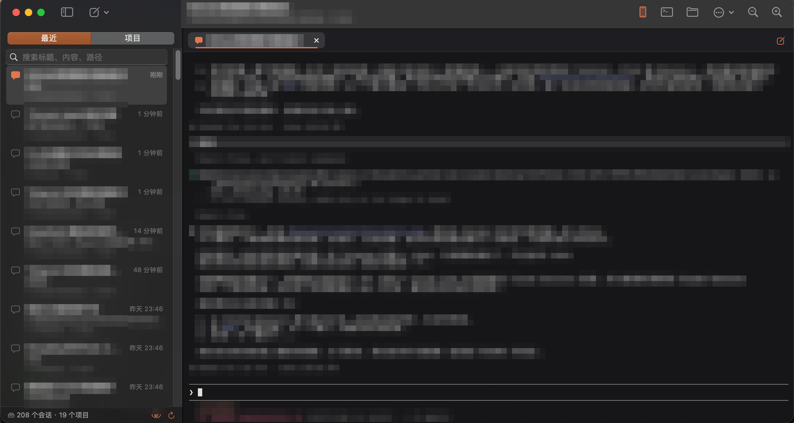
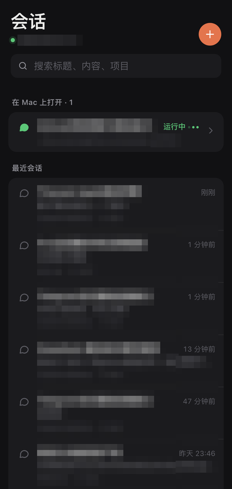

<p align="center">
  
</p>

<h1 align="center">Claude Sessions</h1>

<p align="center">
  <b>A native macOS session manager for <a href="https://docs.anthropic.com/en/docs/claude-code">Claude Code</a>.</b><br>
  Every session from every folder in one window — resume any of them in a tab, or keep chatting from your phone.
  <br><br>
  <a href="#中文">中文说明</a>
</p>

<p align="center">
  
</p>

---

`claude --resume` only shows sessions started in the current directory. Once you use Claude Code across many repos, conversations get scattered: you forget which folder a session lived in, you keep five terminal windows open just to watch them, and when you walk away from the desk a long task stalls on a question nobody answers.

Claude Sessions fixes that. It indexes `~/.claude/projects`, lists **all** your sessions in a searchable sidebar, and runs each one as a real `claude` process in a native terminal tab. Turn on phone access and the same sessions open in your iPhone/Android browser over Wi‑Fi or Tailscale.

It is a **thin shell around the real `claude` CLI**, not a re-implementation — `/model`, slash commands, skills, hooks, MCP servers, permission prompts and image paste all keep working, and new CLI features show up the moment you upgrade `claude`.

## Who it's for

- **You juggle many repos.** Find "that session where we fixed the login bug" by searching titles, prompts or paths instead of `cd`-ing around and running `claude --resume` in each folder.
- **You run several agents in parallel.** Open sessions side by side as tabs and see at a glance which are working, which are idle and which are **waiting for your reply** (with a Dock badge count).
- **You step away while Claude works.** Scan a QR code once, then check progress, answer a question or approve the next step from your phone on the couch — the session keeps running on your Mac.
- **You want a lightweight GUI, not another IDE.** ~6 MB, pure Swift/SwiftUI, no Electron, no account, no cloud relay.

## Features

- **All sessions, one list** — every folder, sorted by recent activity or grouped by project; titles come from Claude Code's own AI-generated or custom titles.
- **Search** titles, first prompts and paths (`⌘K`).
- **Tabs** — several sessions at once, each a real `claude` process in a native terminal ([SwiftTerm](https://github.com/migueldeicaza/SwiftTerm)).
- **Status at a glance** — working / waiting for you / idle, plus a Dock badge for sessions that need a reply.
- **New session anywhere** — pick any folder or one of your recent projects (`⌘T`).
- **Organise** — pin, rename (local alias), hide; copy the `cd … && claude --resume …` command.
- **Phone access (optional)** — a built-in web client (installable as a home-screen app) to browse sessions, continue conversations and use a full terminal from your phone. Hand a tab back to the desktop with one click.

## Phone access



Open the phone icon in the toolbar, switch it on and scan the QR code with your phone camera.

- Works on the same Wi‑Fi, or from anywhere via [Tailscale](https://tailscale.com) (log in to the same account on both devices).
- The server only accepts connections from private networks (LAN / Tailscale) and requires a pairing token; use "Reset pairing" to revoke all paired phones.
- Nothing goes through a third-party server — your phone talks directly to your Mac.
- Optionally keeps the Mac awake while phone access is on.

> Plain HTTP on your private network. Don't expose the port to the public internet; use Tailscale for remote access.

<br clear="right">

## Requirements

- macOS 15+ (the build script targets Apple silicon; Intel works if you change `--arch`)
- Claude Code installed and on your login shell's `PATH` (`which claude`)
- Xcode / Swift 6 toolchain to build

## Install

```bash
git clone https://github.com/hanshengcc/claude-sessions.git
cd claude-sessions
./scripts/bundle.sh --install   # builds "Claude Sessions.app" and copies it to /Applications
```

The app is signed locally, so Gatekeeper won't quarantine it.

## Usage

| Shortcut | Action |
| --- | --- |
| `⌘K` | Search sessions |
| `⌘T` | New session in a folder |
| `⌘W` | Close tab |
| `⌘1`–`⌘9` | Switch tab |
| `⌘⇧[` / `⌘⇧]` | Previous / next tab |
| `⌘+` / `⌘-` / `⌘0` | Terminal font size |
| `⇧↩` | Newline in the Claude prompt |

Open the app on a folder or session from your terminal:

```bash
open -a "Claude Sessions" --args --new "$PWD"
open -a "Claude Sessions" --args --open <session-id>
```

(Launch arguments are only read when the app starts.)

### Notes

- **Permissions flag.** By default sessions start with `--dangerously-skip-permissions`, matching a common `claude` alias. Turn it off in Settings (`⌘,`) to get Claude Code's permission prompts back.
- **Environment.** The app reads your login shell's environment once at launch (`$SHELL -l -i`), so `PATH`, API keys and other variables match your terminal.
- **macOS privacy prompts.** Files that `claude` touches are attributed to this app (as they would be to Terminal or iTerm). If macOS blocks access, allow Claude Sessions in *System Settings → Privacy & Security*.
- **Status detection** is a heuristic: a session is "working" while it produces output and "waiting" after 2 s of silence.

## FAQ

**Is this the official Claude desktop app?** No. It's an unofficial, open-source companion that runs the official `claude` CLI you already have installed.

**Does it send my code or sessions anywhere?** No. It reads local session files and runs `claude` locally. Phone access is a server on your own Mac, reachable only from your private network.

**Does it work with Claude Pro/Max subscriptions or API keys?** Whatever works in your terminal works here — it uses the same `claude` binary and environment.

## Development

```bash
swift test                      # unit tests for the session index and HTTP core
./scripts/bundle.sh             # build the .app without installing
```

```
Sources/
  SessionCore/          # pure, tested: parse ~/.claude/projects/*/*.jsonl, HTTP parsing, output buffer
  ClaudeSessions/       # SwiftUI app: sidebar, tabs, SwiftTerm terminals, phone server
Web/                    # phone web client (xterm.js), bundled into the app
Resources/AppIcon.icon  # Icon Composer source, compiled by bundle.sh with actool
```

Session files are read head + tail only (cwd and first prompt live at the top, titles are re-appended near the end), and results are cached by size + mtime, so even multi-GB history indexes in well under a second after the first run.

To refresh the README icon preview after a build:
`sips -s format png -Z 256 build.noindex/icon/AppIcon.icns --out Resources/AppIcon-preview.png`

## Disclaimer

Unofficial community project. Not affiliated with or endorsed by Anthropic. "Claude" and "Claude Code" are trademarks of Anthropic.

## License

MIT

---

## 中文

**Claude Code 的原生 macOS 会话管理器。** 把所有文件夹里的 Claude Code 会话汇总到一个窗口，点一下就能在标签页里继续对话，也能用手机接着聊。

### 解决什么问题

`claude --resume` 只列出当前目录的会话。项目一多，会话就散落各处：忘了某个对话在哪个文件夹，开着一堆终端窗口盯进度，人一离开电脑，长任务卡在一个问题上没人回复。

### 适合这些场景

- **同时维护很多仓库**：按标题、首条提问、路径搜索会话，不用挨个文件夹 `cd` 进去再 `claude --resume`。
- **并行跑多个 Agent**：多标签同时打开，一眼看出哪个在跑、哪个空闲、哪个**在等你回复**（Dock 图标有角标计数）。
- **离开电脑也想盯着**：扫一次码，在手机浏览器里看进度、回答问题、让它继续干活，会话一直在 Mac 上跑。
- **只想要个轻量界面**：约 6 MB，纯 Swift/SwiftUI，不用 Electron，不用注册账号，不走云端中转。

### 功能


- 所有会话一个列表，可按最近活动或按项目分组；标题沿用 Claude Code 自己生成或自定义的标题。
- 搜索（`⌘K`）、新建会话（`⌘T`）、置顶、重命名、隐藏、复制恢复命令。
- 本质是给官方 `claude` 命令加壳，不是重写：`/model`、斜杠命令、Skills、Hooks、MCP、权限确认、贴图都照常可用，CLI 升级后自动跟上。
- **手机访问（可选）**：工具栏点手机图标开启，用手机相机扫码即可。同一 Wi‑Fi 直连，或用 [Tailscale](https://tailscale.com) 在外面也能连。只接受局域网 / Tailscale 内的设备，需要配对令牌（可随时“重置配对”让旧手机失效），数据不经过任何第三方服务器。可添加到手机主屏当 App 用，手机上能看会话列表、继续对话、开完整终端；电脑上一键收回。

<br clear="right">

### 安装

```bash
git clone https://github.com/hanshengcc/claude-sessions.git
cd claude-sessions
./scripts/bundle.sh --install
```

需要 macOS 15+、Swift 6 工具链，并且已经装好 Claude Code（`which claude` 能找到）。

默认用 `--dangerously-skip-permissions` 启动会话，不需要的话在设置（`⌘,`）里关掉。非 Anthropic 官方项目。
