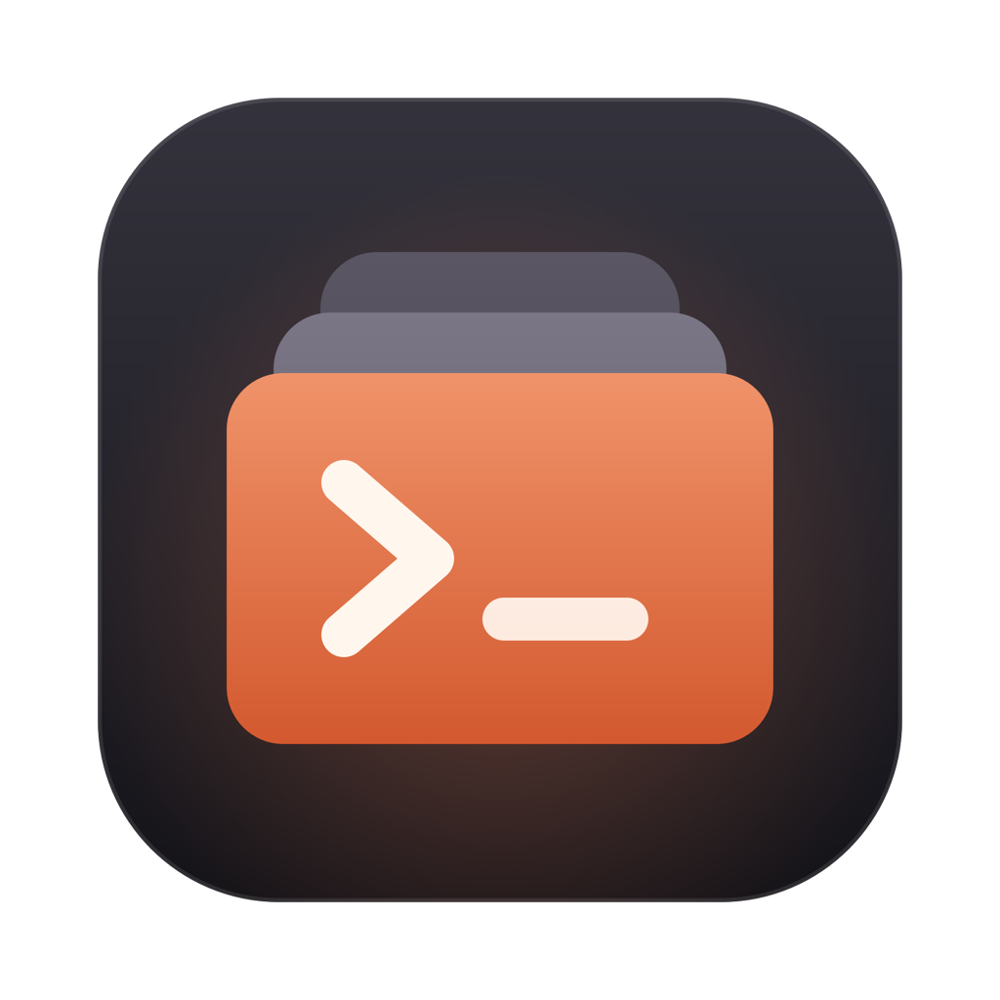

<p align="center">
  
</p>

<h1 align="center">Claude Sessions</h1>

<p align="center">
  A tiny native macOS app that gathers every <a href="https://docs.anthropic.com/en/docs/claude-code">Claude Code</a> session from every folder into one window.
  <br>
  <a href="#中文">中文说明</a>
</p>

---

`claude --resume` only lists sessions for the current directory. If you work across many repos, sessions get scattered and forgotten. Claude Sessions indexes `~/.claude/projects`, shows all of them in a searchable sidebar, and resumes any of them in an embedded terminal with one click.

It is a **shell around the real `claude` CLI**, not a re-implementation. Every Claude Code feature keeps working — `/model`, slash commands, skills, hooks, MCP, permission prompts, image paste — and you get new CLI features the moment you upgrade `claude`.

## Features

- **All sessions, one list** — every folder, sorted by recent activity or grouped by project; titles come from Claude Code's own AI/custom titles.
- **Search** titles, prompts and paths (`⌘K`).
- **Tabs** — open several sessions at once, each a real `claude` process in a native terminal ([SwiftTerm](https://github.com/migueldeicaza/SwiftTerm)).
- **Status at a glance** — working / waiting for you / idle, plus a Dock badge counting sessions that need a reply.
- **New session anywhere** — pick a folder, or one of your recent projects (`⌘T`).
- **Organise** — pin, rename (local alias), hide; copy the `cd … && claude --resume …` command.
- **Small** — ~6 MB, pure Swift/SwiftUI, no Electron, no network access of its own.

## Requirements

- macOS 15+ (Apple silicon build script; Intel works if you change `--arch`)
- Claude Code installed and on your login shell's `PATH` (`which claude`)
- Xcode / Swift 6 toolchain to build

## Build & install

```bash
git clone https://github.com/hanshengcc/claude-sessions.git
cd claude-sessions
./scripts/bundle.sh --install   # builds build/Claude Sessions.app and copies it to /Applications
```

The app is ad-hoc signed. Because it is built locally, Gatekeeper will not quarantine it.

Run the tests:

```bash
swift test
```

Regenerate the icon:

```bash
swift scripts/make-icon.swift && iconutil -c icns Resources/AppIcon.iconset -o Resources/AppIcon.icns
```

## Usage

| Shortcut | Action |
| --- | --- |
| `⌘K` | Search sessions |
| `⌘T` | New session in a folder |
| `⌘W` | Close tab |
| `⌘1`–`⌘9` | Switch tab |
| `⌘⇧[` / `⌘⇧]` | Previous / next tab |
| `⌘+` / `⌘-` / `⌘0` | Terminal font size |
| `⇧↩` | Newline in the Claude prompt |

Open the app on a folder from your terminal:

```bash
open -a "Claude Sessions" --args --new "$PWD"
open -a "Claude Sessions" --args --open <session-id>
```

(Launch arguments are only read when the app starts.)

### Notes

- **Permissions flag.** By default sessions start with `--dangerously-skip-permissions`, matching a common `claude` alias. Turn it off in Settings (`⌘,`) if you want Claude Code's permission prompts.
- **Environment.** The app reads your login shell's environment once at launch (`$SHELL -l -i`), so `PATH`, API keys and other variables match your terminal.
- **macOS privacy prompts.** Files that `claude` touches are attributed to this app (like they would be to Terminal or iTerm). If macOS blocks access, allow Claude Sessions in *System Settings → Privacy & Security*.
- **Status detection** is a heuristic: a session is "working" while it produces output, and "waiting" after 2 s of silence.

## How it works

```
Sources/
  SessionCore/          # pure, tested: parse ~/.claude/projects/*/*.jsonl
  ClaudeSessions/       # SwiftUI app: sidebar, tabs, SwiftTerm terminals
scripts/bundle.sh       # build the .app
scripts/make-icon.swift # draw the icon
```

Session files are read head + tail only (cwd and first prompt live at the top, titles are re-appended near the end), and results are cached by size + mtime, so even multi-GB history indexes in well under a second after the first run.

## Disclaimer

Unofficial community project. Not affiliated with or endorsed by Anthropic. "Claude" and "Claude Code" are trademarks of Anthropic.

## License

MIT

---

## 中文

把所有文件夹里的 Claude Code 会话汇总到一个原生 macOS 窗口里：左边是可搜索的会话列表，右边用多标签终端直接继续对话。

- 本质是给官方 `claude` 命令加壳，不是重写，所以 Claude Code 的功能全都保留，CLI 升级后自动跟上。
- 支持按最近或按项目查看、搜索、置顶、重命名、隐藏；标签页上能看到会话是在跑、等你回复还是空闲。
- 纯 Swift/SwiftUI，约 6 MB，不用 Electron。

安装：`./scripts/bundle.sh --install`。需要 macOS 15+，并且已经装好 Claude Code。
